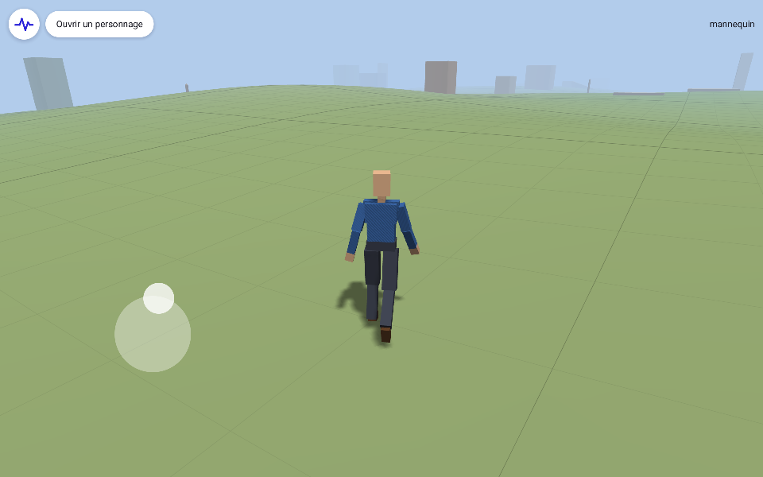

# S.A.G.E.

Moteur de jeu en Rust pour Android : une application native, en OpenGL ES 3, qui
fait vivre les personnages créés dans [Rustcraft](https://github.com/s1pierro/rustcraft).
Il vise un monde ouvert, avec d'autres valeurs que la violence.

## Version 0.17 : voir à 3 km, avec ou sans brouillard

- Au-delà des tuiles chargées, le relief de toute la carte se voit, simplifié (un point
  tous les 64 m) : les montagnes et les côtes de l'île jusqu'à 3 km.
- La caméra tourne autour de la tête du personnage, et non plus de sa taille.
- Réglages › Affichage : « Avec brouillard / Sans brouillard », et le brouillard réglable
  de 30 m à 3 km (règle logarithmique). Sans brouillard, la vue s'arrête net à 3 km.

## Version 0.16 : lever la vue

- En jeu, la vue se lève vers le ciel, jusqu'à environ 60°. Passé l'horizon, la
  caméra descend au ras du sol derrière le personnage et s'en rapproche, garde l'angle
  demandé (le personnage glisse vers le bas de l'image), et le champ s'élargit un peu :
  une perspective en contre-plongée. En édition, la vue reste au-dessus de l'horizon.

## Version 0.15 : le terrassement

- Dans Ajout, l'objet choisi (un bâtiment importé, un bloc…) a une section
  « Terrassement » : sans ou avec sous-sol (profondeur de 1 à 8 m), la marge autour de
  lui, la pente du talus.
- « Terrasser » met la plateforme au niveau du point le plus haut du terrain sous elle
  (en remblai : rien n'est creusé autour), la relie au terrain par un talus, creuse la
  fosse du sous-sol sous l'objet s'il en a un, et y pose l'objet : sur la plateforme, ou
  au fond de la fosse. La terre remuée prend une teinte de terre.
- Une seule annulation défait le tout. Le relief étant une grille de 2 m, les bords de
  la fosse sont en retrait d'un pas sous l'objet : sa pente reste cachée par lui.

## Version 0.14 : l'onglet Carte et la téléportation

- La carte du monde a son onglet dans l'éditeur, « Carte », à côté d'Ajout et de
  Topologie (qui retrouve toute la largeur). À gauche le point visé (position, sol) et
  le joueur ; à droite la carte, sur toute la hauteur.
- Le bouton « Téléporter le joueur ici » le pose au point visé, sur le sol ; pas en eau
  profonde, ni là où le sol n'est pas encore chargé. « Viser le joueur » ramène la vue
  sur lui.

## Version 0.13 : l'érosion

- Le relief de l'île passe par une érosion hydraulique : des centaines de milliers de
  gouttes coulent selon la pente, arrachent la terre où elles vont vite et la déposent
  où elles ralentissent. Les montagnes se ravinent, les vallées se creusent et leurs
  fonds se comblent, la terre emportée finit en deltas.
- Elle se calcule une fois par graine, en quelques secondes et à part du jeu, puis
  s'enregistre (`erosion.bin`, environ 7,5 Mo). « Régénérer la carte… » attend
  qu'elle soit prête ; un monde d'avant la 0.13 s'érode au premier lancement.
- Les couleurs s'en ressentent : fonds de vallée plus verts, ravines rocheuses, terre
  déposée plus brune.
- `examples/erosion.rs` essaie d'autres réglages et en fait une image.

## Version 0.12 : la carte du monde

- En Topologie, le panneau s'élargit et se scinde : les outils à gauche, à droite la
  carte du monde entier sur toute la hauteur. Un pixel par tuile, la couleur du sol
  ombrée par le relief, la mer plus sombre au large.
- Elle montre le point visé et la direction de la vue, la zone chargée autour, et le
  joueur. La toucher ou y glisser y emmène le point visé.
- Les retouches du relief s'y voient (l'image se refait au plus deux fois par seconde),
  celles déjà enregistrées comprises.

## Version 0.11 : une île

- La carte porte une île d'environ 15 km, au contour découpé de caps et de baies, au
  milieu de la mer. Le fond descend vers -35 m au large ; la mer cache le bord de la
  carte.
- Une chaîne de montagnes en crêtes, d'un côté de l'île, monte vers 900 m. Ailleurs,
  des plaines et des collines ; près du rivage, le relief s'efface en plages douces.
- Les couleurs suivent le relief : sable des plages, herbe plus ou moins sèche, lande en
  altitude, roche dans les pentes et vers les sommets, fond de la mer.
- La mer est un plan d'eau jusqu'à l'horizon : houle, reflet du ciel plus fort de biais,
  éclat du soleil, plus transparente vue d'en haut. Le joueur entre dans l'eau jusqu'à
  1,2 m de fond, pas au-delà.
- Une carte d'avant change de relief : « Régénérer la carte… » la remet à neuf, sans
  coutures entre les anciennes tuiles retouchées et les nouvelles.

## Version 0.10 : une carte finie, nue, à régénérer

- La carte fait 20 km de côté : 313 tuiles de 64 m, centrées sur le départ. Au bord, le
  joueur s'arrête comme contre un mur ; au-delà il n'y a rien, que le ciel. L'éditeur
  voit le bord mais ne le passe pas.
- Le générateur ne fait plus que le relief et ses couleurs : la carte est nue, les
  objets se posent à la main. Les tuiles déjà retouchées gardent les leurs.
- « Régénérer la carte… », au bas de l'onglet Topologie, tire une graine au hasard (une
  autre au besoin), dit ce qui sera effacé et attend la confirmation. Tout repart de
  zéro : relief, retouches, objets posés ; le catalogue des modèles reste, et le joueur
  revient au départ.

## Version 0.9 : l'éditeur en pause, la topologie et les poignées

- Le panneau d'édition ouvert, le jeu se met en pause et le personnage disparaît. La
  caméra tourne autour d'un point du sol : la manette le déplace, deux doigts qui
  glissent aussi, et l'on peut s'éloigner jusqu'à 150 m. On voit jusqu'à 1 km, sans
  brouillard. Refermé, le joueur reprend où il était.
- L'éditeur a deux onglets. **Ajout** est l'ancien éditeur. **Topologie** retouche le
  relief au pinceau : Monter, Creuser, Aplanir, Adoucir, Peindre la couleur du sol, avec
  un rayon et une force. Chaque coup de pinceau s'annule, et les tuiles retouchées
  s'enregistrent comme les autres.
  La vue y va jusqu'à la verticale et s'éloigne jusqu'à 2 km ; seul le relief est
  dessiné, avec ses courbes de niveau, dont l'écart suit la hauteur de la vue, et
  l'altitude sous le doigt.
- Dans l'onglet Ajout, l'objet choisi a des poignées : le disque blanc le fait glisser
  sur le sol, les flèches le poussent le long de ses axes ou en hauteur, la pastille
  jaune de l'anneau le tourne (au pas de 5°). Chaque geste est une étape d'annulation.

## Version 0.8.2 : les faces des décors

- Un décor dont les faces regardent vers l'intérieur est retourné à l'import, et le
  message le dit. C'est le cas des fichiers des visualiseurs web qui dessinent tout des
  deux côtés, comme ceux tirés de GTA San Andreas.
- « Retourner ses faces », dans l'éditeur, retourne le modèle à la main, pour tous ses
  objets. Le choix est gardé au catalogue (`"faces"`).
- Un matériau `doubleSided` se voit des deux côtés : feuillages, grilles, vitres.
- Le nom d'un modèle exporté sous « AuxScene » est celui de son fichier.

## Version 0.8.1 : l'affichage

- Les réglages ont un second onglet, Affichage, avec deux curseurs :
  - **la distance d'affichage**, c'est-à-dire jusqu'où les tuiles du monde sont
    chargées : de 64 à 320 m, par tuile de 64 m (128 m à l'origine) ;
  - **le brouillard**, c'est-à-dire là où le lointain a disparu dans le ciel : de 30 m
    jusqu'au bord des tuiles chargées (144 m à l'origine).
- Les tuiles se chargent ou se libèrent au fil des images, sans attendre.
- Les deux réglages sont gardés dans `reglages/affichage.json`.

## Version 0.8 : décors et bâtiments en .glb

- « Ouvrir un .glb » accepte aussi les décors et les bâtiments. Un modèle sans
  squelette entre au catalogue de l'application, sous son identifiant
  (`extras.sage.id` s'il en porte un, sinon `glb/<n>`). L'éditeur s'ouvre aussitôt
  sur AJOUTER, avec le nouveau modèle.
- Le modèle est d'abord posé : son point le plus bas va au sol, et il est centré s'il
  n'a pas son origine dans son emprise. Ses matériaux, couleurs et textures (PNG,
  JPEG) viennent du fichier.
- Chaque objet posé se règle par son cap, son échelle (de ÷ 100 à × 100, pour les
  fichiers en centimètres) et son enfoncement dans le sol.
- La collision suit ses triangles : on marche sur un plancher, on bute contre un mur.
- La tuile ne garde que la référence du modèle, avec la position, le cap et l'échelle.
  Si le fichier manque, l'objet devient une boîte grise d'un mètre, et retrouve sa
  forme dès que le modèle revient. « Remplacer le fichier du modèle » met une nouvelle
  version à la place de l'ancienne, pour tous les objets qui le montrent.
- Limites :
  - sont refusés les maillages compressés (Draco, meshopt) et les textures KTX2 ou
    WebP ;
  - les animations sont ignorées ;
  - au-delà de 50 000 triangles, le modèle est signalé comme lourd à dessiner et à
    heurter.

## Version 0.7 : les manettes de jeu

- Une manette branchée ou appairée en Bluetooth est détectée à sa première touche, et
  fonctionne aussitôt avec une assignation automatique :
  - le stick gauche fait marcher, le droit tourne la vue ;
  - les gâchettes approchent et éloignent la vue ;
  - A choisit l'objet au centre de la vue et X annule, dans l'éditeur ;
  - Select ouvre le moniteur, Y l'éditeur, Start les réglages, et B ferme le panneau.
- Une troisième pastille, l'engrenage, ouvre les réglages. Leur onglet Manette montre :
  - la manette détectée et un témoin en direct de ses sticks et de ses touches ;
  - chaque action et ce qui la commande. On touche une ligne puis on appuie sur la
    touche voulue ou on pousse le stick voulu ; si la touche servait déjà, les deux
    actions s'échangent ;
  - la zone morte des sticks, la vitesse de la vue, et l'inversion verticale.
- Chaque manette garde son profil d'un lancement à l'autre, sous son descripteur
  Android. « Rétablir l'assignation automatique » l'efface.
- Chaque pastille ouvre le panneau sur ses propres onglets.
- Les sticks ne sont plus pris pour des doigts, et B ne quitte plus l'application.

## Version 0.6 : l'édition du monde

- Une seconde pastille, au crayon, ouvre l'éditeur dans le panneau de gauche.
- Touchez un objet dans la vue pour le choisir : il passe en surbrillance. Vous pouvez
  alors :
  - le déplacer d'un appui là où le poser ;
  - le tourner ;
  - changer ses dimensions, son altitude et sa couleur ;
  - le dupliquer ou le supprimer.
- Le catalogue ajoute des blocs, des dalles, des poteaux et des rampes là où l'on
  touche. « Annuler » défait le dernier changement.
- Chaque objet du décor est désormais une entité, sous un identifiant stable.
- Le monde s'enregistre seul dans le stockage de l'application, une tuile modifiée
  entière à la fois :
  - 2 s après un changement ;
  - quand la tuile se décharge ;
  - quand l'application passe en arrière-plan.
- Au lancement suivant, on retrouve le monde tel qu'on l'a laissé, et le joueur là où il
  était.

## Version 0.5 : le rendu

- Les ombres portées : le personnage et le décor portent leur ombre au soleil, sur le
  sol, les dalles et les uns les autres, autour du joueur.
- Les matériaux et les textures du `.glb` sont dessinés : chaque matériau avec sa
  texture, son opacité, et ses parties transparentes. La veste du mannequin a un sergé.
- Le dessin est trié par programme et par texture ; ce qui est transparent vient en
  dernier, du plus loin au plus proche.
- Les tuiles lointaines ont un terrain simplifié : moitié moins de triangles à dessiner.

## Version 0.4.2 : l'inclinaison et le regard

- Le buste penche avec l'élan : en avant quand le personnage part, en arrière quand il
  freine, vers l'intérieur dans les virages.
- La tête regarde ce que vise la caméra : tourner la vue sur le côté ou vers le haut fait
  tourner la tête, dans les limites du cou ; en courant, le regard reste plus près de la
  route ; quand la caméra le regarde de face, il regarde devant lui.
- Le moniteur montre l'inclinaison du buste et le regard.

## Version 0.4.1 : les pieds calés au sol

La dernière couche de l'animation pose les pieds sur le monde :

- un pied posé ne glisse plus : il reste là où il s'est posé jusqu'à ce que l'animation
  le lève ;
- chaque pied se pose sur ce qu'il y a sous lui : au bord d'une dalle, l'un est dessus et
  l'autre au sol, et le bassin descend pour qu'il l'atteigne ;
- sur une pente, le pied en prend l'inclinaison ;
- une marche montée d'un coup est amortie ;
- les genoux plient dans leurs limites, sans jamais se retourner ;
- le moniteur montre chaque pied (tenu, lâché ou levé) et la descente du bassin.

## Version 0.4 : la physique

Le personnage a un corps, une capsule de 1,75 m qui pèse :

- il monte les marches jusqu'à 35 cm sans s'arrêter, et gravit les pentes jusqu'à 45° ;
  au-delà, il ne monte plus et glisse vers le bas ;
- au bord d'une plate-forme, il tombe, à la pesanteur ;
- il bute contre les boîtes, les poteaux (des capsules) et les maillages de collision,
  rangés dans une grille de cases de 2 m, et glisse le long ;
- la campagne en a de chaque sorte : dalles basses à enjamber, poteaux, et une rampe
  qui mène à une plate-forme, une tuile sur deux ;
- des rayons servent au jeu : la caméra se rapproche quand un obstacle la cache, et le
  moniteur montre ce que vise le centre de l'écran, jusqu'à 80 m ;
- le moniteur montre aussi ce qui porte le joueur (le relief ou un objet) et la pente
  sous ses pieds.

## Version 0.3.1 : marche et course, et le personnage qui respire

Le personnage se déplace comme on l'a animé dans Rustcraft :

- marche et course jouées à une même phase, leurs contacts de pied alignés ; la course
  prend le pas entre 1,9 et 2,4 m/s, au-delà seule la cadence change ;
- la cadence suit la vitesse : une foulée par cycle, si bien que la dérive des pieds
  ne dépend pas de la vitesse ;
- à l'arrêt, le mélange d'attente du `.glb` en couches (« Repos vivant » : transfert
  d'appui et respiration) ; sa respiration additive, masquée au haut du corps, reste
  par-dessus la marche et la course ;
- le moniteur montre la part du mouvement et de la course, et ce que joue le
  personnage.

## Version 0.3 : le monde en tuiles

Le joueur marche dans une campagne sans fin, en tuiles de 64 m :

- les 25 tuiles autour du joueur sont chargées, une par image pour éviter les
  à-coups, et déchargées au-delà de trois tuiles ;
- les positions sont relatives à la tuile du joueur, qui sert d'origine : le monde se
  décale d'une tuile quand il en change, et reste précis à n'importe quelle distance ;
- chaque tuile a son identifiant (`tuile/i/j`), un relief en collines et des blocs posés
  dessus ; deux tuiles voisines s'accordent exactement sur leur bord ;
- le joueur suit le relief ; le lointain se fond dans le ciel ;
- le moniteur montre les tuiles chargées, le temps de génération, la tuile et la
  position absolue du joueur.

## Version 0.2.1 : le moniteur

La pastille en haut à gauche déploie le panneau latéral (en haut, en portrait), qui
montre en direct :

- les images : cadence, intervalle et pire intervalle, courbe des 120 dernières
  images (repères à 60 et 30 images par seconde), temps du jeu, de l'envoi au rendu
  et de l'échange des tampons ;
- la simulation : pas fixes par seconde et par image ;
- le monde : entités, objets dessinés, triangles, maillages et leur poids ;
- le joueur : position, cap, vitesse, part de la marche dans l'animation.

La 3D se dessine dans la place que laisse le panneau, redimensionnable à sa poignée.

## Version 0.2 : le socle du moteur

Le jeu de la 0.1 tourne maintenant sur un moteur à part entière :

- un monde d'entités désignées par des poignées, avec leurs composants (lieu, rendu,
  squelette, obstacles, mobilité) ;
- une simulation à pas fixes de 1/60 s, dont les images sont interpolées : le jeu se
  comporte de la même façon à toutes les cadences ;
- des maillages enregistrés sous leur identifiant et versionnés : seul ce qui change
  repart au processeur graphique ;
- une scène extraite du monde à chaque image, seule chose que lit le moteur de rendu.

Le socle se poursuit par le monde en tuiles, la physique et le rendu ; voir
[`docs/architecture.md`](docs/architecture.md).

## Version 0.1 : un personnage jouable

- Ouvre un `.glb` exporté par Rustcraft pour S.A.G.E. (armature, peau, animations)
  et le garde pour le prochain lancement ; un mannequin intégré sert en attendant.
- La peau est déformée sur le processeur graphique (48 os au plus).
- Les animations de repos et de marche se mêlent selon la vitesse, et leur rythme
  suit le pas. Elles sont reconnues par leur nom (« repos », « idle »… ;
  « marche », « walk »…). Une animation seule sert de marche.
- Manette tactile sur la gauche de l'écran ; ailleurs, un doigt tourne la caméra et
  deux doigts l'approchent.
- Le personnage marche sur un sol quadrillé, parmi des blocs qu'il ne traverse pas.

Pour les appareils ARM 64 bits, sous Android 8.0 ou plus récent, avec OpenGL ES 3.

## Organisation

- `src/moteur/` : le moteur, sans Android ni OpenGL : entités et composants
  (`entites`), temps à pas fixe (`horloge`), maillages (`ressources`), scène à dessiner
  (`scene`), tuiles et origine flottante (`tuiles`), corps, obstacles et rayons
  (`physique`), allures (`locomotion`), posture (`posture`), pieds calés (`pieds`), systèmes de marche et d'animation
  (`systemes`) ;
- `src/moteur/objets.rs`, `src/moteur/depot.rs` : les objets du décor et leur
  catalogue ; le dépôt du monde en JSON ;
- `src/campagne.rs` : la source de tuiles générée ;
- `src/editeur.rs` : l'éditeur du monde, dans le panneau de gauche (onglets Ajout et
  Topologie, poignées de l'objet choisi) ;
- `src/terrain.rs` : le pinceau qui retouche le relief des tuiles ;
- `src/manette.rs`, `src/reglages.rs` : les manettes de jeu (actions, profils,
  assignation) et l'onglet Manette des réglages ;
- `src/image.rs` : les textures PNG et JPEG, décodées ;
- `src/jeu.rs` : le jeu bâti sur le moteur (manette, caméra, décor, interface,
  panneau) ;
- `src/moniteur.rs` : les mesures du moniteur ;
- `src/personnage.rs` : le personnage relu d'un `.glb`, mis à plat pour le
  processeur graphique ; le mannequin intégré et ses animations ;
- `src/renderer.rs`, `src/gles.rs` : le rendu OpenGL ES de la scène (carte d'ombre,
  sol, objets statiques ou à peau, matériaux et textures, interface) ;
- `src/android.rs`, `java/` : l'activité native, le sélecteur de fichiers ;
- `src/ui.rs`, `widgets.rs`, `shell.rs`, `draw.rs`, `text.rs` : l'interface tactile et
  ses panneaux, reprise de
  [Rustine](https://github.com/s1pierro/Rustine).

Le modèle (maillages, armatures, peaux, animations, lecture et écriture du `.glb`)
vient de la crate [`gda`](https://github.com/s1pierro/gda-modele), partagée avec Rustcraft. Le format est décrit
dans `rustcraft/docs/format-gda.md`.

## Construire

La crate `gda` doit se trouver à côté de `sage`, dans un dossier nommé `gda` :

    git clone https://github.com/s1pierro/sage
    git clone https://github.com/s1pierro/gda-modele gda

Puis, dans Termux :

    bash build.sh                              # → dist/sage.apk
    cargo test                                 # le jeu sans écran
    cargo run --release --example apercu -- <dossier> [personnage.glb]
                                               # images PPM rendues sur le GPU

## Licence

[PolyForm Noncommercial 1.0.0](LICENSE.md).
